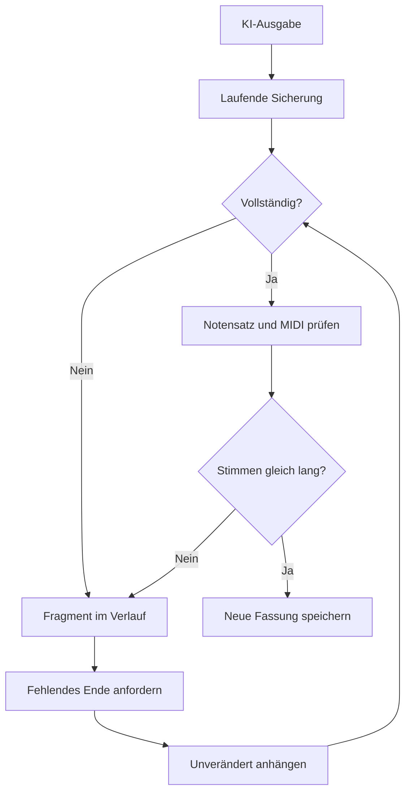

# V1.1.0 · Wiederherstellung abgebrochener Kompositionen

Die Oberfläche von V1.0 bleibt erhalten. Bei einem Fragment erscheint unter dem Compilerhinweis zusätzlich **Komposition vervollständigen**. Der Button startet einen zusätzlichen KI-Aufruf mit dem gewählten Modell und Denkaufwand. Ein bloßer Verbindungsaufbau startet keinen neuen Kompositionsauftrag.

## Datenfluss

## Zuständigkeiten

- `provider-stream.mjs`: SSE einschließlich UTF-8- und Paketgrenzen, Kosten, Anbieterfehlern nach HTTP 200 und verlorenem Antwortende. Empfangener Text wird spätestens nach weiteren 2048 Zeichen oder bei einem nach zwei Sekunden eintreffenden Ereignis gespeichert. Die abschließende Sicherung enthält den zuletzt empfangenen Stand. Die laufende Antwort erhält ein Zeitlimit von zehn Minuten.
- `composition-recovery.mjs`: Strukturprüfung ohne Treffer aus Kommentaren oder Zeichenketten; Fortsetzungsauftrag und unveränderliches Anhängen, auch nach einem mitten im Token abgebrochenen Fragment. Wiederholte Dokumente und vorhandene Stimmdefinitionen werden verworfen.
- `score-completeness.mjs`: gleiche Gesamtdauer der Notensysteme anhand der von LilyPond aufgelösten rationalen Musikdauern. Eine nur 13 Takte lange Hand neben 72 Takten kann trotz gültiger Syntax nicht als erfolgreiche Vervollständigung durchgehen.
- `run-session.mjs`/`run-client.mjs`: derselbe Auftrag wird nach Browserabbruch oder Neuladen abgefragt; unvollständige Ergebnisse gelten als fehlgeschlagen, werden aber mit Notentext angezeigt. Gleichzeitige Aufrufe derselben Kennung im selben Serverprozess werden zusammengeführt. Eine nach 90 Sekunden ohne Aktualisierung unterbrochene Serververarbeitung kann aus dem letzten Kontrollstand wiederhergestellt werden.
- `worker/index.js`: verschlüsselter gespeicherter Schlüssel, neue Historienfassung, Kosten, Modellprotokolle und Kompilierung. Schlüssel werden nicht in Fortsetzungsdaten oder Browser-Wiederherstellung gespeichert.

Die ursprüngliche Historienfassung wird nicht überschrieben. Erfolgreiche Fortsetzungen können die vorhandenen Zeichen nicht verändern. Automatische Oktavzeichen dürfen für die Anzeige gerendert werden, werden im Fortsetzungsweg aber nicht in den geschützten Quelltext zurückgeschrieben. Erneut abgebrochene Ergänzungen bleiben als neuer Ausgangspunkt erhalten. Abgelehnte Ergänzungen und ihre erfassten Kosten bleiben im Diagnoseprotokoll und in den Stufen nachvollziehbar.

Eine Fortsetzung ist eine neue Rekonstruktion fehlender Musik, kein Wiederauffinden der ursprünglichen internen KI-Ausgabe. Kein Netzwerk kann Zeichen wiederherstellen, die der Anbieter nie übertragen hat. Nach einem harten Serverabbruch kann außerdem der kurze Abschnitt seit der letzten erfolgreichen Sicherung fehlen. Es gibt keine unbegrenzten kostenpflichtigen Wiederholungen. Künstlerische Überzeugungskraft ist keine durch den Compiler bestätigte Eigenschaft.

## Verifikation am 18.10.2026

- Alle 22 Testprogramme: vorhandene Kompositions- und Ideenabläufe, Modell- und Denkstufenauswahl, Verlauf, Arbeitsstand, SoundFonts, Player, MIDI-Synchronität, Oktavnotation, Hacklily und MusicXML sowie neue Fragment-/Fortsetzungsprüfungen.
- Zusätzliche Fälle: Anbieterfehler bei HTTP 200, Tokenlimit, fehlender oder offener Score, wiederholter Abbruch, veralteter Server-Kontrollstand, keine automatischen kostenpflichtigen Wiederholungen, geschütztes Original, Kosten und Modellstufen, Fortsetzungsbutton nach Neuladen.
- „Brumes sur l'étang silencieux“: tatsächlicher Aufruf von `google/gemini-4-argon`, hoher Denkaufwand; neue linke Hand T.14–72. Alle 7250 Bytes des Originalfragments bleiben als unveränderter Präfix erhalten. Reine Notensatzangaben und Herkunftskommentar stehen im ergänzten Abschnitt.
- Echter Online-Renderer und lokales LilyPond 2.24.3; 72 Takte 6/8, beide Systeme 54 ganze Noten bzw. 216 Viertel. MIDI-Ereignisse der rechten Hand und der linken Hand T.1–13 stimmen mit getrennt kompilierten Originalstimmen überein. Beide Hände enden gemeinsam. Spielbarer Klaviertonumfang bestätigt.
- MusicXML aus der echten Compilerstruktur: ein Klavier, zwei Systeme, 72 Takte. Der Export meldet seine bekannte nicht übertragene BarCheck-Struktur ausdrücklich; sie ist ein Compiler-Prüfzeichen ohne klingende Noten.

Die Oberfläche wird durch Ausführung ihrer tatsächlichen Ereignisbehandlung in einem DOM-Testmodell geprüft. Eine echte Sicht- und Audioprüfung auf iPad/Android ist in dieser Umgebung nicht erfolgt. Die Tests enthalten synthetische Anbieter- und Rendererantworten für Fehlerfälle; die genannten Brumes-Compiler- und Modellprüfungen sind echte Aufrufe.
